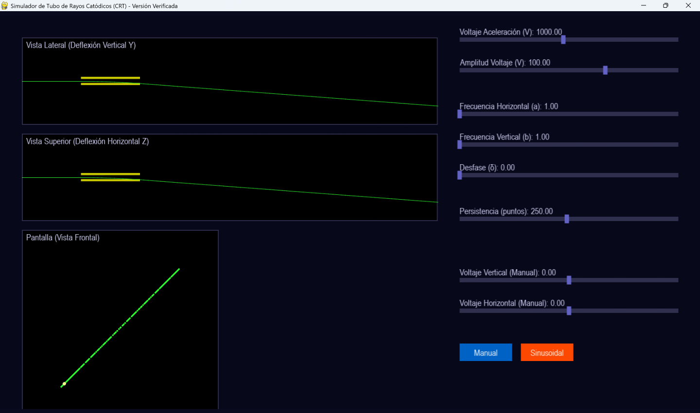

# Proyecto Física 3

## Simulador CRT

Juego construido con el fin de utilizar un CRT de manera sencilla para estudiantes que quisieran experimentar cómo ciertas variables cambian las gráficas de lo que se obtiene a partir de funciones sinusoidales. Permite cambiar los siguientes parámetros:

- Voltaje aceleración
- Amplitud de voltaje
- Frecuencia horizontal
- Frecuencia vertical
- Desfase
- Persistencia
- Voltaje vertical (en función manual)
- Voltaje horizontal (en función manual)

### Captura del inicio de la simulación



## Requerimientos:

- Python 3.12
- pygame
- numpy
- Windows

## Para correrlo

Desde PowerShell, en la carpeta del proyecto, instala las dependencias y ejecuta el simulador:

```powershell
py -3.12 -m venv .venv
.\.venv\Scripts\python.exe -m pip install -r requirements.txt
.\.venv\Scripts\python.exe simulador_crt.py
```

La ventana se ajusta al tamaño de la pantalla al abrirse y se puede redimensionar
arrastrando sus bordes.

Si `py -3.12` no encuentra Python, sustituye ese comando por la ruta completa
al ejecutable de Python 3.12 para crear el entorno virtual.

## Demo del proyecto funcionando

<video controls width="720">
  <source src="assets/DemoSimulaciónCRT.png.mp4" type="video/mp4">
  Tu navegador no admite la reproducción de video. También puedes
  <a href="assets/DemoSimulaciónCRT.png.mp4">abrir o descargar la demo</a>.
</video>